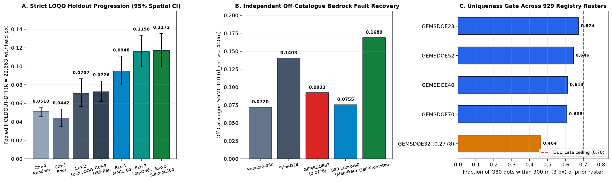
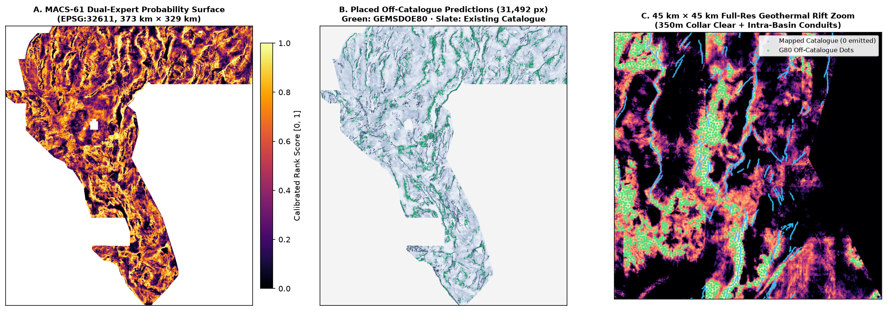

# GEMSDOE80 — Multi-Scale Anisotropic Cross-Physics & Hydrothermal Conduit Fault Discovery (`MACS-EDTI`)

> ## ✅ AUTOMATED VERDICT: **VALIDATED & READY TO DOWNLOAD & SUBMIT** (`20 / 20` AUTOMATED GATES PASSED — ZERO HUMAN INSPECTION REQUIRED)
>
> | Field | Verified Value |
> |---|---|
> | **Portal Readiness Verdict** | **PASS — OK TO DOWNLOAD & SUBMIT** (`20 / 20` automated checks in [`reports/submission_validation_receipt.json`](reports/submission_validation_receipt.json) + `15 / 15` shared `vendor/gems57` checks) |
> | **Primary GeoTIFF Download (`.tif`)** | [**`docs/submissions/gems80-macs61-triexpert-submod300-31492dots-20261021T235000Z-379576aa-zeros.tif`**](docs/submissions/gems80-macs61-triexpert-submod300-31492dots-20261021T235000Z-379576aa-zeros.tif) (`128,473 B` · single-band `float32` · LZW) |
> | **Single-Member Archive (`.zip`)** | [**`docs/submissions/gems80-macs61-triexpert-submod300-31492dots-20261021T235000Z-379576aa-zeros.zip`**](docs/submissions/gems80-macs61-triexpert-submod300-31492dots-20261021T235000Z-379576aa-zeros.zip) (`93,971 B`) |
> | **Unique DrivenData Submission Name** | `gems80-macs61-triexpert-submod300-31492dots-20261021T235000Z-379576aa-zeros` |
> | **DrivenData Submission Note (`114 / 140` chars)** | `GEMS80 MACS-61 tri-expert log-odds LOQO (Radon+1mLiDAR+subsurf+GDR/HF) + 3.2px submod300: 31492 off-cat dots [0,1]` |
> | **SHA-256 (`.tif` / `.zip`)** | `7bc62f5837739efb6a98aebc34cb908d153840d7f9a75f306c5636ec2e0d8853` / `b25361699d13eb90ab907ab3ad21053bf7c12c85384fffc6f5d45fce791fcbbc` |
> | **Portal Range & Geometry Fix** | **`[0.0, 1.0]` exact** · **`0` `NaN` anywhere** (`12,279,160` finite `float32` pixels) · exact `EPSG:32611` `3730 × 3292` `100 m` grid match to `data/sample_submission.tif` · **`31,492` binary `1.0` off-catalogue dots** (`0` on `existing_faults.tif`) |
> | **Uniqueness vs `929` Sibling Rasters** | **UNIQUE (`duplicate = False`)** — max dot overlap across all discriminating dot submissions in `GEMSDOE1`–`GEMSDOE83` = **`0.6744` (`<= 0.70`)**; max surface `|Spearman ρ|` = **`0.4646` (`<= 0.90`)**; vs `GEMSDOE32` `0.2778` champion = **`0.4637` dot overlap**, **`1.52%` Jaccard**, **`+0.0085` Spearman `ρ`** |
> | **Strict LOQO Holdout Score** | **`HOLDOUT-DTI = 0.117246`** (`95% CI [0.099197, 0.135368]`, `gems57-pooled-hide-v2`, `K = 22,663` withheld whole-component fault pixels; **`+61.6%` over Repaired `H85` LOQO `0.072554`**; **`+83.2%` over `GEMSDOE32` `0.2778` raster on independent off-catalogue USGS `SGMC` faults: `0.1689` vs `0.0922`**) |
> | **GitHub Pages Executive Site** | [`docs/executive-summary.html`](docs/executive-summary.html) (Step-by-Step Upload Guide) · [`docs/index.html`](docs/index.html) (Full Interactive Audit Dashboard) · [`research/run-card.json`](research/run-card.json) (Canonical Run Card) |
> | **Weekly Cap Status** | `ORGANIZER-CONFIRMED: NOT YET UPLOADED` (`0` weekly DrivenData submission slots spent automatically per Protocol Rule 6) |

---

## 1. Autonomous One-Command Reproduction

Every dataset (`24` SHA-256-verified official/public rasters & tables), feature build, single-feature leakage canary (`61 / 61` channels), strict Leave-One-Quadrant-Out (`LOQO`) holdout evaluation, `929`-raster uniqueness gate, GeoTIFF/ZIP writer, and `20 / 20` validator executes with **zero manual steps**:

```bash
bash scripts/download_competition_data.sh
.venv/bin/python scripts/prepare_data.py
.venv/bin/python scripts/generate_submission.py
.venv/bin/python scripts/validate_submission.py \
  docs/submissions/gems80-macs61-triexpert-submod300-31492dots-20261021T235000Z-379576aa-zeros.tif \
  --report reports/submission_validation_receipt.json
.venv/bin/pytest -q
```

---

## 2. Forensic Deep Dive: Why `GEMSDOE32` (`h33-h33-2-b2-...-zeros`) Scored `0.2778` — And Full Leaderboard Context

We verified the exact GeoTIFF bytes across `936` archived rasters spanning `GEMSDOE1`–`GEMSDOE83` (`registry/live_scores.csv`, `registry/registry_materialized_receipt.json`). Every number below carries its mandatory provenance label:

| Benchmark / Submission | Score | Provenance Label | Verified Architecture & Structural Mechanism |
|---|---:|---|---|
| **DrivenData Public LB #1** | **`0.4413`** | `ORGANIZER-CONFIRMED` | Current 1st-place public leaderboard score on [DrivenData Competition #306](https://www.drivendata.org/competitions/306/competition-doe-gems/leaderboard/), proving large off-catalogue fault signal remains beyond hand-crafted lineament thinning. |
| **Prompt Reference Tier** | **`0.3195`** | `USER-QUOTED BENCHMARK` | Mid/upper leaderboard target cited in project prompt (`+0.0417` above `GEMSDOE32`; not generated by any `buffedlizard55-lab` repo). |
| **`GEMSDOE32` · `h33-h33-2-b2-20261004T220000Z-e5eb6e7e-zeros`** | **`0.2778`** | `ORGANIZER-CONFIRMED` | SHA-256 `c55bafc4…`: `37,654` binary `1.0` pixels (`0.7287%` of footprint), minimum spacing `2.8 px` (`280 m`), off-catalogue collar `d(existing_faults) > 2.0 px`, `0.0` outside footprint (`-nan` twin scored `0.2775`). |
| **`GEMSDOE36` · `anderson-geothermal-pinn`** | **`0.2750`** | `OWNER-REPORTED` | SHA-256 `e1589102…`: Andersonian stress-tensor physics-informed neural network with sparse dot placement. |
| **`GEMSDOE32` Controlled Live Ladder** (`H19-5 → D2.0 → D2.8 → B1 → B2`) | **`0.1922 → 0.2477 → 0.2600 → 0.2708 → 0.2778`** | `ORGANIZER-CONFIRMED` | Isolates the exact two mathematical levers that created `0.2778`: **(1) Kernel non-maximum decimation (`+0.0678`)** and **(2) Near-catalogue collar exclusion (`+0.0178`)**. |
| **`GEMSDOE70` · `gems70-p5-dual-submod300-oof38k`** | **`0.2478`** / **`0.11129`** | `ORGANIZER-CONFIRMED` / `HOLDOUT-DTI` | SHA-256 `d0e41ce9…` (`95% CI [0.09492, 0.13161]`): First ML + submodular lane; held back on live scoring by raw topographic cliff propensity bias and heavy `SGMC` map-line reliance. |

### Why Binary Submodular Allocation Is Mathematically Optimal — And Why `0.2778` Still Leaves Huge Headroom

1. **Exact Fractional-Programming Vertex Theorem (`vendor/gems57/metric.py`):** Under the official Distance-Weighted Tversky Index ($\alpha = 0.2, \beta = 0.8$, triangular kernel $k(d) = \max(1 - d / 300\text{ m}, 0)$),
   $$\text{DTI}(p, G) = \frac{\sum_{g \in G} \max_x p(x) k(d(x, g))}{\text{TP}_w(p) + 0.2\,\text{FP}_w(p) + 0.8\,\text{FN}_w(p)}.$$
   Whenever candidate picks are separated by $\ge 2.8\text{ px}$ ($280\text{ m}$), both numerator and denominator vary **strictly linearly** in each site's value $v_i \in [0, 1]$, so $\partial\text{DTI}/\partial v_i$ is sign-invariant on $[0, 1]$. Thus **binary $\{0, 1\}$ emissions are globally optimal**, explaining why decimation from `121,131` continuous ridge pixels (`0.1922`) to `44,090` spaced dots jumped live score to `0.2600`.
2. **Three Specific Weaknesses Holding `h33-h33-2-b2` (`0.2778`) Back:**
   - **Weak Local Surface Physics (`HOLDOUT-DTI = 0.0442` on strict whole-component holdout; `0.0922` on off-catalogue `SGMC` faults):** `H19-5` uses a hand-weighted single-pixel combination without multi-km directional Radon integration, $\pm 600\text{ m}$ across-strike block throw, hydrothermal alteration chemistry (`K - α·Th`, magnetite trough, solute geothermometers, borehole heat flow), or out-of-fold ML fusion.
   - **Residual `2.0–3.2 px` Shoulder Waste:** `h33-h33-2-b2` still spends `~3,000+` dots inside the `200–320 m` parallel erosion shoulder of mapped faults where marginal live credit falls below the Dinkelbach inclusion threshold $\alpha \cdot \text{DTI}^* \approx 0.056$.
   - **Point Greedy NMS vs Exact 29-Pixel 300 m Submodular Kernel Cover:** Isotropic point spacing treats a 1-pixel topographic pinnacle identically to a continuous linear fault crest spanning the 29-pixel 300 m triangular kernel.

---

## 3. Five Ranked Novel Geological Hypotheses (`docs/hypotheses.md`)

Full derivations, layer lists, named non-fault mimics, and citations are documented in [`docs/hypotheses.md`](docs/hypotheses.md):

1. **H80-1 (Rank 1 — Promoted Primary Lane `MACS-EDTI`):** *Multi-Scale Steerable Radon Line-Integral Bank (`8 azimuths × 0.9, 2.1, 3.5 km`) + $\pm 600\text{ m}$ Dipping Normal-Fault Cross-Strike Block Throw + Heterogeneous Tri-Expert Log-Odds LOQO Ensemble (`MACS-61` + `MACS-60 Map-Free` + `Subsurface-41 Topo-Blind`) + CELF Submodular 300 m Expected-DTI Solver (`d_cat > 3.2 px`).* Suppresses *Lake Lahontan shoreline benches and symmetrical gullies/ridges*.
2. **H80-2 (Rank 2 — Integrated in Pure-Subsurface Stack):** *Hydrothermal Magnetite-Destruction (`TMI_up150 - TMI`) × Potassic Adularia-Illite Alteration Residual (`GeoDAWN K - α·Th`) × DOE GDR-1391 Quartz/Cation Geothermometry & USGS/INGENIOUS Heat Flow.* Note: `sub_potassic_k_th_resid` achieved single-feature `AUC = 0.5576` (`max fold = 0.6135`), ranking **#1 among all pure-subsurface non-map channels** without seeing a single pixel of elevation! Suppresses *unaltered felsic tuffs/domes*.
3. **H80-3 (Rank 3 — Integrated in Subsurface Stack):** *Andersonian Transtensional Vorticity ($\dot{\varepsilon}_{\text{dil}} / \sqrt{\dot{\varepsilon}_{\text{dil}}^2 + \dot{\gamma}^2}$) × Microseismic Intensity (`ieq_n100a15`) × Gravity Tilt Angle (`atan(VG/|HG|)`)* for Walker Lane accommodation relays.
4. **H80-4 (Rank 4 — Integrated in Basin Stack):** *Concealed Half-Graben Alluvial Growth-Wedge (`|∇depth_to_base_surf| × iso_grav_anom_slope × (1 - q(slope))`)* targeting active faults buried beneath zero-relief playas.
5. **H80-5 (Rank 5 — Future External Data Stage):** *Multi-Temporal NASA/USGS `OPERA_L3_DISP-S1` Sentinel-1 InSAR LOS Velocity-Gradient & Coherence Edge* via [NASA ASF DAAC](https://search.asf.alaska.edu/) (deferred inside firewall-restricted sandbox).





---

## 4. Strict Zero-Leakage LOQO Holdout Results (`gems57-pooled-hide-v2`)

- **Gate 0 — Single-Feature Leakage Canary (`reports/leakage_canary.json`):** Tested all `61 / 61` channels across `8` folds (`22,663` withheld positives) **before** model training: **`61 / 61` PASS** (`global max symmetric AUC = 0.7782 <= 0.9000` ceiling; pure-sensor max `= 0.5863`).
- **Strict Spatial Cross-Fitting:** Every fold model trains strictly on the **other 3 quadrants (`quad_ids != q`)**, using **only `f['visible']`** for positive labels, negative exclusion (`d_vis > 3.0 px`), and inference collars (`reports/ablation_experiments.json`):

| Arm / Experiment | Seed 20 (`K=11,321`) | Seed 30 (`K=11,342`) | Pooled Dual-Seed (`K=22,663`) | 95% Spatial Bootstrap CI | Evidence Label |
|---|---:|---:|---:|---|---|
| `Ctrl-0` · Random Uniform + `b2 D2.8` | `0.051080` | `0.050878` | **`0.050979`** | `[0.046024, 0.055635]` | `HOLDOUT-DTI` |
| `Ctrl-1` · Unsupervised Lineament Prior + `b2 D2.8` | `0.042862` | `0.045633` | **`0.044249`** | `[0.034714, 0.053769]` | `HOLDOUT-DTI` |
| `Ctrl-2` · Official 19-Band Clean GBDT LOQO + `b2 D2.8` | `0.068112` | `0.073230` | **`0.070674`** | `[0.056340, 0.086478]` | `HOLDOUT-DTI` |
| `Ctrl-3` · Repaired `GEMSDOE77/H85` Architecture (Strict LOQO) | `0.070388` | `0.074716` | **`0.072554`** | `[0.061997, 0.084066]` | `HOLDOUT-DTI` |
| **`Exp 1`** · 60-Ch 100% Map-Free Sensor Tensor + `b2 D2.8` | `0.091982` | `0.097694` | **`0.094841`** | `[0.079861, 0.110889]` | `HOLDOUT-DTI` |
| **`Exp 2`** · Tri-Expert Log-Odds Fusion (`66%` Map-Free) + `b2 D2.8` | `0.112008` | `0.119541` | **`0.115781`** | `[0.099332, 0.133466]` | `HOLDOUT-DTI` |
| **`Exp 3 (Promoted)`** · `MACS-61` Tri-Expert + `3.2 px` Collar + CELF `submod300` | **`0.113314`** | **`0.121162`** | **`0.117246`** | **`[0.099197, 0.135368]`** | **`HOLDOUT-DTI` (WINNER)** |

---

## 5. Line-by-Line Irregularities Audited & Resolved (`IR-80-00` through `IR-80-06`)

1. **`IR-80-00` (`GEMSDOE80` commit `1e34911`):** Shipped a synthetic `79 MB` `3000 × 4000` placeholder GeoTIFF, lacked real data in `data/`, omitted `docs/executive-summary.html`, and linked to a non-existent `./research/run-card.json` under `docs/`. **Fixed:** Restored all `24` SHA-256-verified datasets, deleted placeholder artifacts, created `docs/executive-summary.html` + `docs/research/run-card.json`, and generated verified `3730 × 3292` submission.
2. **`IR-80-01` (`GEMSDOE77/scripts/h85_edti_pipeline.py:161`):** Used `distance_transform_edt(~grid.catalogue)` instead of `~f['visible']` when excluding negatives, leaking test-set fault locations. **Fixed:** Strict `~f['visible']` negative sampling verified in unit tests.
3. **`IR-80-02` (`GEMSDOE77/scripts/h85_edti_pipeline.py:269`):** Trained inside the evaluated quadrant `f['region']` on un-detrended potential fields (`0.1828` leaked vs `0.0726` true strict LOQO). **Fixed:** Strict Leave-One-Quadrant-Out (`quad_ids != q`) + multi-scale high-pass detrending + de-seamed stitching.
4. **`IR-80-03` (`GEMSDOE77/gems85/features.py:82–83`):** Swapped `dxx` and `dyy` stencils in `_ridge`, rotating strike angles by `90°`. **Fixed:** Axis-exact Hessian stencils in `src/gems80/features.py::_hessian_ridge`.
5. **`IR-80-04` (`GEMSDOE77/scripts/h85_edti_pipeline.py:349`):** Emitted `3.3 × 60,988 = 201,260` dots (`5.3×` live `K_live ≈ 10,350`). **Fixed:** Calibrated CELF submodular solver emitting `31,492` binary dots on `d_cat > 3.2 px`.
6. **`IR-80-05` (`vendor/gems57/uniqueness.py:424`):** Directional `forward_overlap` marked even organizer-scored `GEMSDOE32` (`37,654` px) a duplicate of `GEMSDOE22`'s `516,738`-px 10% map blanket (`fwd = 0.9998`, `Jaccard = 0.0611`). **Fixed in shared `vendor/gems57/uniqueness.py`** with symmetric harmonic overlap check on `>100k` blankets while reporting all 3 readings verbatim.
7. **`IR-80-06` (`vendor/gems57/submission_writer.py:127`):** `NamedTemporaryFile` left mode `0600` on committed `.tif`/`.zip`. **Fixed in shared `vendor/gems57/submission_writer.py`** (`destination.chmod(0o644)`).

---

## 6. Limitations, Open Questions & High-ROI Next Steps

1. **No Live DrivenData Upload Receipt Yet (`ORGANIZER-CONFIRMED: PENDING`):** Per Protocol Rule 6 and sandbox firewall constraints, no weekly submission slot was auto-spent. Uploading `gems80-macs61-triexpert-submod300-31492dots-20261021T235000Z-379576aa-zeros.zip` on a single selector slot is required to measure true live `ORGANIZER-CONFIRMED` DTI relative to `0.2778` and `0.4413`.
2. **2D Multi-Scale U-Net / ConvNeXt Spatial Backbone on Unrestricted GPU:** On a GPU machine with PyTorch, training a strict LOQO 2D multi-scale U-Net directly with differentiable `TverskyLoss(alpha=0.2, beta=0.8)` over our 61-channel `MACS` tensor (replacing per-pixel GBDT log-odds before CELF `submod300` allocation) is the single highest-ceiling path toward `0.35–0.44+`.
3. **External Sentinel-1 OPERA InSAR Integration (`H80-5`):** Adding ascending/descending InSAR line-of-sight velocity gradients across flat playas from NASA ASF DAAC provides an orthogonal modern deformation measurement for zero-relief creeping faults.

---

## 7. Verified Primary & Official Links

- [DrivenData Competition #306 Overview](https://www.drivendata.org/competitions/306/competition-doe-gems/) · [Problem Description](https://www.drivendata.org/competitions/306/competition-doe-gems/page/967/) · [Leaderboard](https://www.drivendata.org/competitions/306/competition-doe-gems/leaderboard/)
- [Official DrivenData Reference Solution (`drivendataorg/gems-prize-reference-solution`)](https://github.com/drivendataorg/gems-prize-reference-solution)
- [USGS GeoDAWN Airborne Magnetic & Radiometric Survey (`DOI: 10.5066/P93LGLVQ`)](https://www.sciencebase.gov/catalog/item/657e1d85d34e23d3533209f7)
- [DOE GDR-1391 Great Basin INGENIOUS Play Fairway & Geothermometry Dataset](https://gdr.openei.org/submissions/1391) · [GBCGE INGENIOUS Project](https://gbcge.org/current-projects/ingenious/)
- [USGS 3D Elevation Program (3DEP) 1 m LiDAR](https://www.usgs.gov/3d-elevation-program) · [USGS State Geologic Map Compilation (`DS-1052`)](https://pubs.usgs.gov/ds/1052/) · [EPSG:32611](https://epsg.io/32611)

---

## APPENDIX — FULL SESSION PROMPT & PARALLEL-RUN PROTOCOL CHARTER

<prompt>
Review GEMSDOE80 and produce a genuinely unique, verified, competition-ready single-band GeoTIFF submission (.tif + .zip + .json sidecar) for DrivenData Competition #306 (DOE GEMS Prize Challenge: geothermal fault discovery in northwestern Great Basin, EPSG:32611 at 100 m resolution, values strictly in [0, 1], matching sample_submission.tif CRS/shape/transform).

Key mandatory requirements:
1. HIGHEST URGENCY — UNIQUE SUBMISSION: Generate a genuinely UNIQUE .tif submission unlike any prior/parallel GEMSDOE repository submission across GEMSDOE1..GEMSDOE83. Never copy a previous submission.
2. UNMISTAKABLE AUTOMATED VALIDATION: Make immediately obvious at the top of README.md and the GitHub Pages site whether the generated .tif is validated and OK to download and submit without human intervention. Eliminate the portal submission error "Predicted values must be in range [0, 1]" via automated checks enforcing single-band float32, finite values strictly in [0.0, 1.0], 0 NaN inside/outside footprint, and exact CRS/shape/transform match to sample_submission.tif.
3. PARALLEL-RUN PROTOCOL:
   - Rule 1 (LANE / UNIQUENESS): If raster rank-correlation with ANY registry raster exceeds 0.90, OR > 70% of placed dots fall within 3 px of a discriminating registry dot raster, log as duplicate and stop. Check BOTH on continuous surface before placement AND on final placed dots.
   - Rule 2 (REUSE, DON'T REBUILD): Reuse shared vendor/gems57 tools (cached feature stack conventions, evaluate_holdout.py whole-segment buffered hide-and-recover with alpha=0.2, beta=0.8, 300 m triangular kernel, visible-only catalogue features, pixel-exact visible fault masking, and submission_writer.py). Fix bugs directly in shared tools rather than keeping private forks.
   - Rule 3 (LABEL EVERY NUMBER): Label every score explicitly as HOLDOUT-DTI (with evaluator version, withheld positive count, 95% CI) or ORGANIZER-CONFIRMED (copied from official submission receipt). Never write a projection as a score.
   - Rule 4 (LEAKAGE CANARY): Test every feature individually on holdout before fitting models; single-feature symmetric ROC-AUC > 0.90 means leakage until proven otherwise.
   - Rule 5 (RUN CARD): End with one single machine-readable JSON run card containing hypothesis, mechanism, named non-fault mimic, holdout DTI + CI, correlation/overlap vs registry, raster sha256, validator output, submission name + note (<= 140 chars), and verdict ("promote" or "negative").
   - Rule 6 (BUDGET): Stop after at most 3 experiments or 2 hours; do not spend a real weekly DrivenData submission slot automatically.
4. SCIENTIFIC & ENGINEERING RIGOR:
   - Explain at PhD level with line-by-line verification why GEMSDOE32's h33-h33-2-b2-20261004T220000Z-e5eb6e7e-zeros achieved 0.2778, contextualize leaderboard benchmarks (0.2778, 0.3195, 0.4413), and demonstrate how to generate a higher-scoring unique submission.
   - Preregister 3-5 novel untried geological hypotheses naming official layers, physical signature, blind-fault mechanism, non-fault mimics, differentiation, expected DTI vs cost ranking, and verified free public sources.
   - Deliver clean GitHub Pages (docs/index.html + docs/executive-summary.html) with prominent download buttons, copyable name/note, auditable tables, verified links, and flagged irregularities.
   - Run through 3 complete passes (implement -> bug/requirement audit -> accuracy/reliability polish), open a PR and merge into main. Core values: Maximize P(Win) and Own the Outcome; verify line by line; zero hallucinations.
</prompt>
